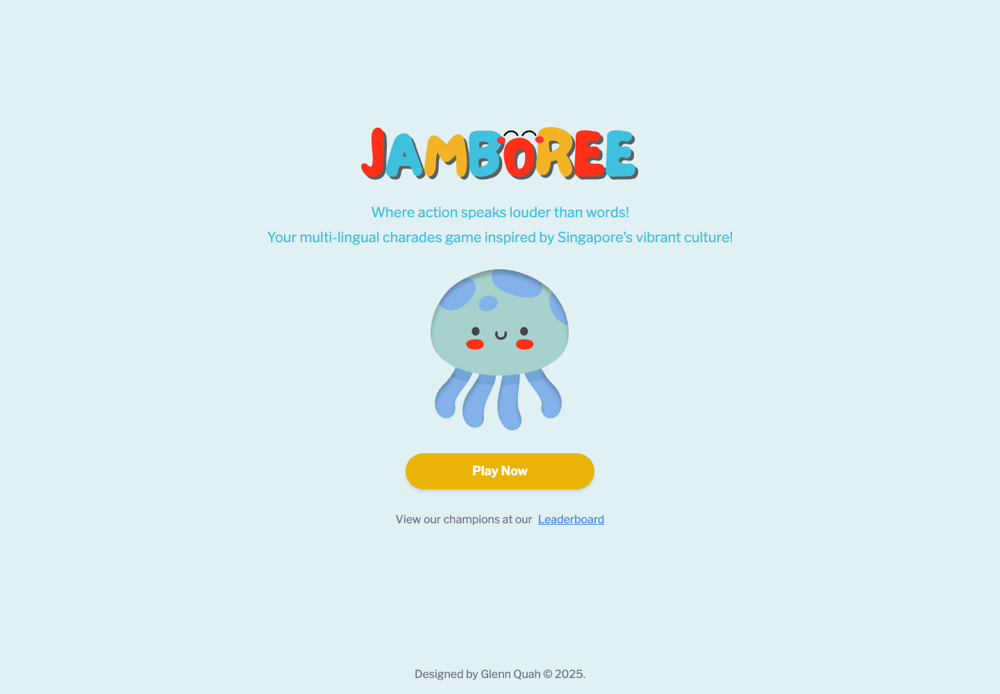
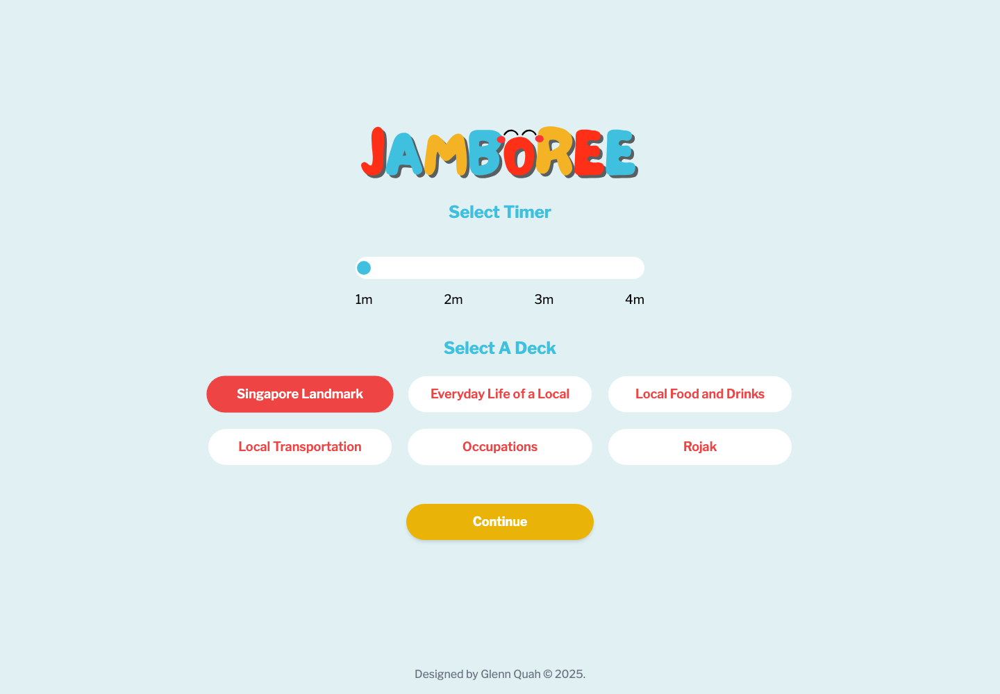
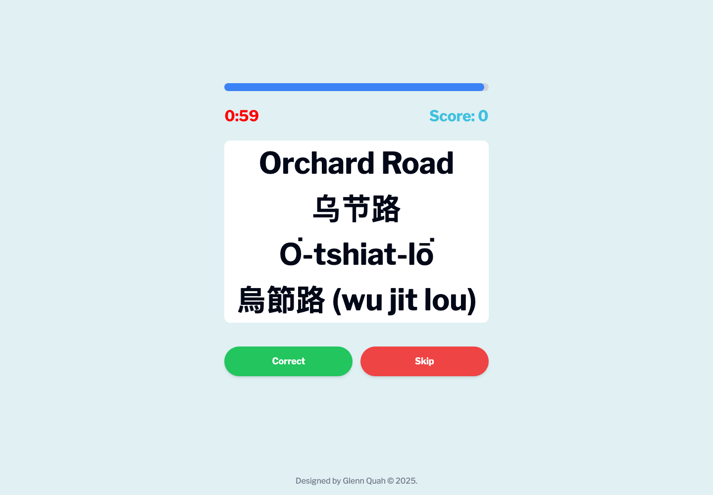
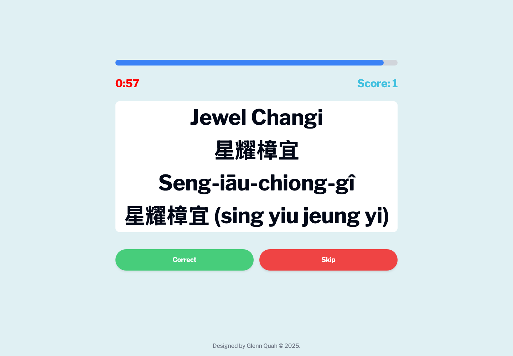
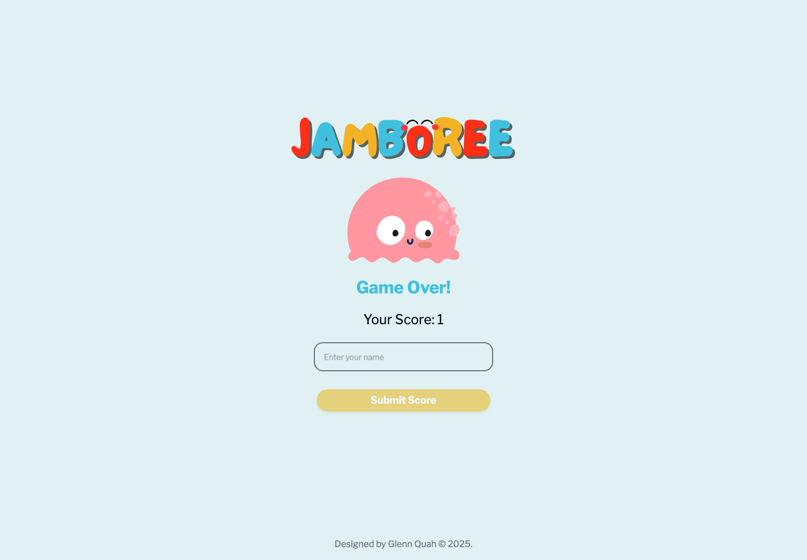
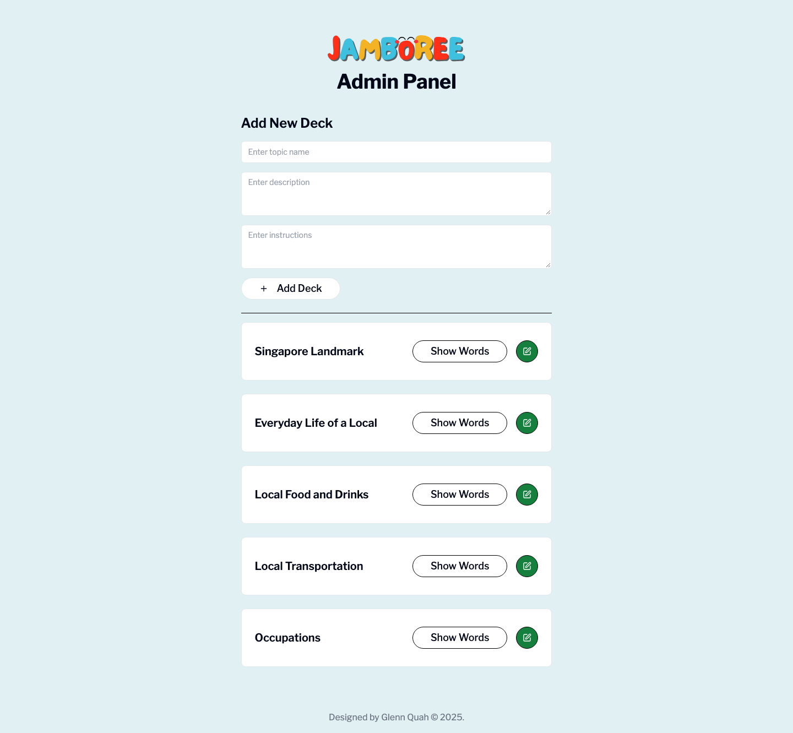
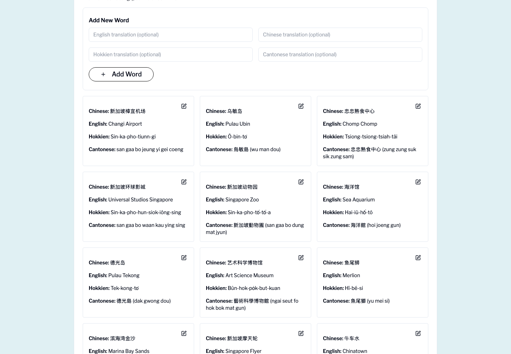
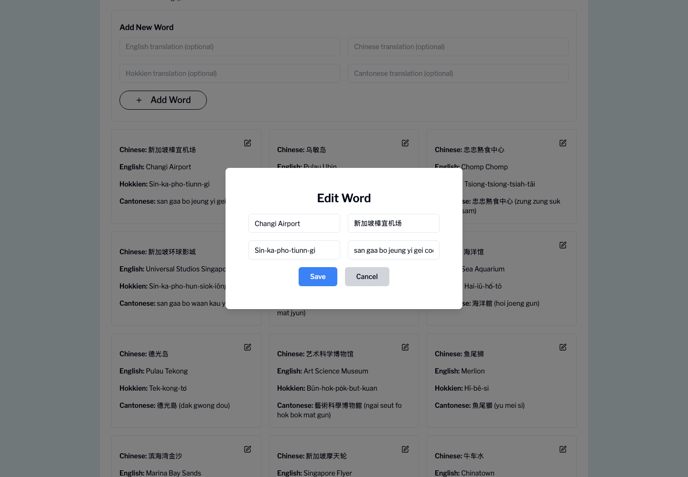
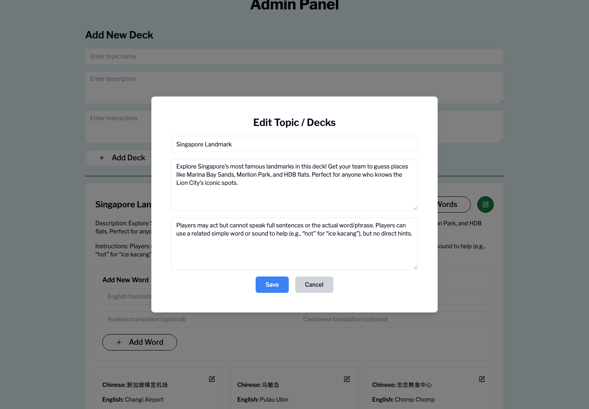

# Jamboree

A multilingual charades game inspired by Singapore’s everyday life and culture. Pick your languages, choose a deck, and get everyone guessing together.

**Featured in GEN2060X and used at real get-togethers with seniors.** Built to bring people together through familiar words, shared laughter, and a little friendly competition.

> **A huge shoutout to the NTUC Health team at Bukit Merah!** Thank you for being part of bringing the game to life and sharing it with seniors in the community.



## How it works

1. Choose English, Chinese, Hokkien, Cantonese, or a combination. Available translations depend on the deck.
2. Choose a one- to four-minute round and a deck, or pick **Rojak** for a mix of all decks.
3. Have one player act out the prompt while everyone else guesses. Tap **Correct** or **Skip** to move on.
4. Submit a nickname and compare scores on the leaderboard.

| Set up a round | Play together |
| --- | --- |
|  |  |

| A live round after a correct guess | Round results |
| --- | --- |
|  |  |

Screenshots were captured with Playwright against the running game database. They show actual decks and prompts, with no participant names or leaderboard records. These are app screenshots rather than photographs of gatherings.

## Run locally

Requires Node.js 24 LTS and npm.

```sh
npm ci
cp .env.example .env.local
```

Create your own Supabase project. For a **new, empty project**, run [the initial schema](supabase/migrations/202611150001_initial_schema.sql), [deletion protection](supabase/migrations/202611150002_disable_public_deletion.sql), and then [the sample seed](supabase/seed.sql) in its SQL editor. Alternatively, with the Supabase CLI and Docker installed, run `supabase start` and `supabase db reset` to initialize a local database. Resetting deletes local database data.

Put your project's URL and public anon/publishable key in `.env.local`:

```dotenv
VITE_SUPABASE_URL=http://127.0.0.1:54321
VITE_SUPABASE_ANON_KEY=your-public-anon-key
```

Use `supabase status` to find local credentials. Never use a service-role or secret key in a `VITE_` variable: Vite includes these values in browser bundles.

```sh
npm run dev
```

Open http://localhost:8080. Without configuration, the app displays setup instructions. The sample seed includes English and Chinese prompts; add reviewed Hokkien and Cantonese translations before running those languages at an event.

## Manage decks

The `/admin` dashboard is public and does not require sign-in. Anyone with access can add or edit shared decks and words. Public deletion is disabled in the UI and blocked by the supplied database migration. Use a separate Supabase project for your own instance and keep backups of event decks.

Use **Add New Deck** to create a deck with its description and instructions. Select **Show Words** on a deck to view its prompts, add translations in English, Chinese, Hokkien, or Cantonese, and use each word's pencil button to adjust translations. The deck's pencil button edits its name, description, and instructions. Deletion is reserved for trusted database administration; it is unavailable in the public portal.



| Browse and add words | Adjust translations |
| --- | --- |
|  |  |




The initial migration targets fresh databases. Existing deployments can run [the deletion protection migration](supabase/migrations/202611150002_disable_public_deletion.sql) separately to revoke public delete/truncate privileges and reject deletes from browser roles, including through database functions. Existing policies should be reviewed separately.

Scores are client-submitted and publicly readable. Use nicknames, avoid personal information, and treat the leaderboard as casual event scoring. Public deployments needing abuse prevention should add server-side validation and rate limits.

## Development

```sh
npm run lint
npm run typecheck
npm run build
npx playwright install chromium
npm run test:e2e
```

Playwright checks desktop and mobile gameplay, scoring, word exhaustion, and the public dashboard against intercepted sample API responses. It does not validate a live Supabase deployment or its access policies. The test server supplies fixture credentials and never contacts the original database. Test images are saved as test artifacts and do not overwrite README images.

`npm run screenshots` uses the real database configured in `.env.local` to capture gameplay and the public admin portal (overview, word list, word editor, and deck editor). It blocks database writes and leaderboard reads, and does not submit a score or change words. The database must be running and contain at least one deck with words.

Built with React, TypeScript, Vite, Tailwind CSS, shadcn/ui, Framer Motion, React Query, and Supabase. Vercel's SPA rewrite is included; other static hosts should rewrite unknown paths to `index.html`.

## Contributing and credits

Bug reports and pull requests are welcome. Include reproduction steps and screenshots for UI changes, and run the checks above before submitting. Keep real participant data, credentials, and local environment files out of commits.

Designed by Glenn Quah. Thanks again to the NTUC Health team at Bukit Merah and everyone who played together.

## License

Source code and original written documentation are available under the [MIT license](LICENSE). Branding, artwork, and screenshots are subject to the separate [asset notice](NOTICE.md). Confirm redistribution permission for those assets before making a branded release public.
